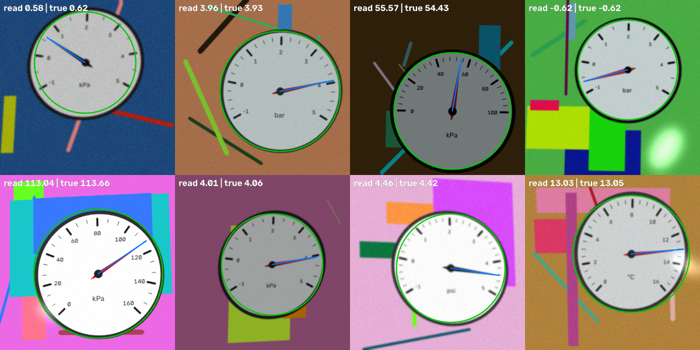

# gauge-reader

Reading analog pressure and temperature gauges from camera images, for autonomous robotic
inspection: detect the dial, find the needle, convert its angle into a value. The current classical
computer-vision pipeline reads synthetic gauges with realistic distortions to within **0.42% of full
scale** on average, at **~15 ms per image** on a laptop CPU.



*Synthetic test images with clutter, perspective, blur, noise and glare. Green: detected dial.
Blue: detected needle. Label: pipeline reading vs ground truth.*

> 🚧 **Work in progress.** The classical pipeline and the synthetic benchmark are done. Next come
> evaluation on real photos, a YOLO dial detector, and a ROS 2 node (see the roadmap).

## Results

Benchmark: 1,000 generated gauges per condition, with 5 dial layouts (270°, 240° and 180° scales,
different ranges and units). Error is |read − true| as a percentage of the full-scale range.

| Condition | Mean error | 95th percentile | Within 1% FS | Within 2% FS | Detection failures | Time / image |
|---|---|---|---|---|---|---|
| Clean, frontal | 0.25% | 0.83% | 98.1% | 100% | 0 | 15 ms |
| **Realistic** (clutter, perspective, blur, noise, glare, lighting) | **0.42%** | **1.03%** | **94.1%** | **99.8%** | **0** | **15 ms** |

For comparison, many industrial gauges have an accuracy class of 1–2.5% of full scale, so the reading
error is already below the instrument's own uncertainty on synthetic data. Timing was measured on an Apple M3 CPU,
single thread, with no GPU.

**What made the difference:** the first version used the Hough circle centre directly, and under
perspective that centre drifts from the needle's pivot. Moving the centre onto the hub
(morphological opening removes the thin needle and keeps the round hub) cut the centre error from
5% to 0.5% of the radius, and the realistic-case error from 1.40% to 0.42% of full scale.

## How it works

1. **Dial detection:** Hough circle transform on the median-filtered image gives the gauge face.
2. **Centre refinement:** the needle pivot (hub) is located as the compact dark blob near the centre.
   This is the true rotation centre even when the rim appears elliptical.
3. **Needle search:** a polar sweep integrates darkness along rays from the centre, between 20% and 60%
   of the radius. This avoids the tick marks, labels and needle tail. The search is limited to the
   calibrated scale, and the darkest ray is the needle.
4. **Angle refinement:** a weighted principal-axis fit on the needle pixels gives a sub-degree angle that
   does not depend on small centre errors.
5. **Value:** the angle is mapped linearly onto the scale using the gauge's calibration
   (start/end angle and values), which is configured once per gauge, as in a real inspection route.

The synthetic generator ([synthetic.py](src/gauge_reader/synthetic.py)) produces images with exact
ground truth. This makes it possible to measure accuracy, find failure modes and add regression tests before any real
photos are labelled.

## How to run

```bash
git clone https://github.com/dariaproniakova/gauge-reader.git
cd gauge-reader
python -m venv .venv && source .venv/bin/activate
pip install -r requirements.txt
pip install -e .

# read one image (scale from 0 to 10, starting at 7:30 and ending at 4:30)
python -m gauge_reader.read --image path/to/gauge.jpg --min 0 --max 10 \
    --min-angle 225 --max-angle 135 --debug annotated.png

# reproduce the benchmark (writes results/metrics.json and results/examples.png)
python -m gauge_reader.evaluate --n 1000

# run the tests
pytest
```

Angles are in degrees, clockwise from 12 o'clock: 225 = 7:30, 135 = 4:30, 270 = 9:00, 90 = 3:00.

## Project structure

```
src/gauge_reader/
  dial.py        scale calibration and angle conventions
  geometry.py    angle -> value mapping (handles scales that wrap past 12 o'clock)
  reader.py      dial detection, centre refinement, needle angle, visualisation
  synthetic.py   synthetic gauge generator with ground truth
  evaluate.py    benchmark script
  read.py        command-line tool
tests/           unit and accuracy tests (pytest)
results/         benchmark metrics and figures
ros2/            ROS 2 node (planned)
data/README.md   real image data (planned)
```

## Roadmap

- [x] Angle → value conversion with tests
- [x] Synthetic gauge generator with realistic distortions
- [x] Classical pipeline: Hough dial detection, hub-based centre, polar needle search, line-fit refinement
- [x] Benchmark and accuracy tests
- [ ] Real photo test set (own photos and a public gauge dataset) with labelled values
- [ ] YOLO dial detector, for small or far-away gauges in cluttered scenes (feeds `read_gauge(img, spec, dial=...)`)
- [ ] Ellipse fit and perspective rectification for strongly oblique views
- [ ] ROS 2 node (camera topic in, readings out) and Docker image

## What I learned / limitations

- Synthetic data with exact ground truth turned a vague "it looks right" into a measurable error.
  It showed straight away that the centre estimate, not the needle detection, was the main error source.
- **Limitations:** the results so far come from synthetic images. Real gauges add reflections on
  the glass, shadows from the needle, unusual needle shapes and strong viewing angles. The
  pipeline also assumes a dark needle on a light face, and a known calibration for each gauge.

## License

MIT
